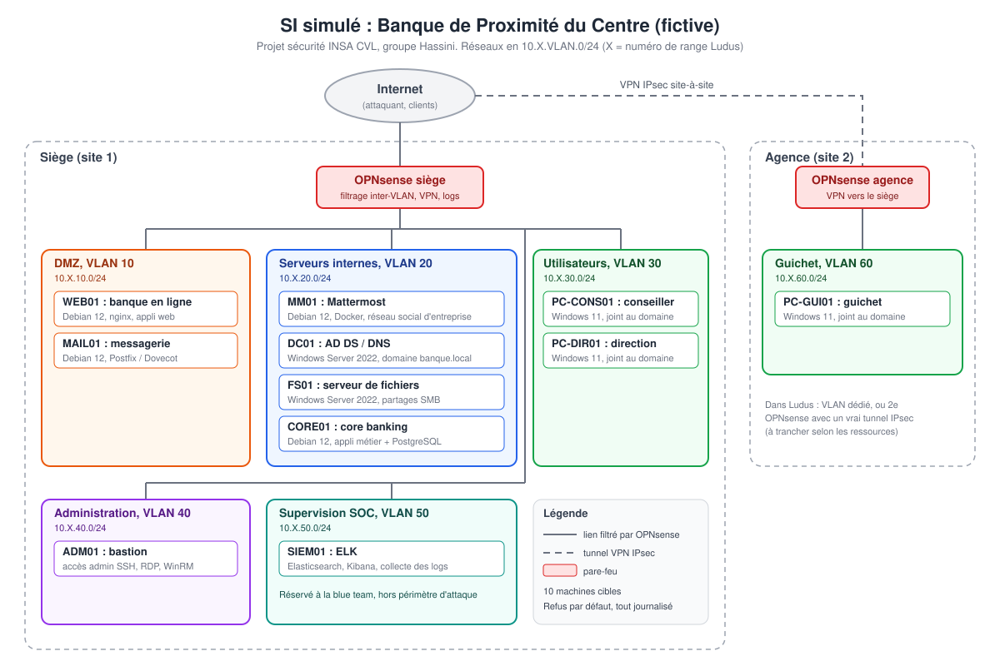

# Architecture du SI : Banque de Proximité du Centre (fictive)

## Contexte

La Banque de Proximité du Centre (BPC) est une petite banque régionale fictive d'environ 120 collaborateurs, répartis entre un **siège** (direction, back-office, informatique) et une **agence** (accueil clientèle, guichet). Le SI simulé comporte **10 machines cibles** ; le SIEM est réservé à l'équipe blue team et reste hors du périmètre d'attaque.

## Zones et plan d'adressage

Convention Ludus : chaque réseau est en `10.X.VLAN.0/24`, où `X` est le numéro de range. La passerelle de chaque VLAN (OPNsense) est en `.254`.

| Zone | Site | VLAN | Réseau | Rôle |
|---|---|---|---|---|
| DMZ | Siège | 10 | 10.X.10.0/24 | Services exposés sur Internet |
| Serveurs internes | Siège | 20 | 10.X.20.0/24 | AD, fichiers, Mattermost, core banking |
| Utilisateurs | Siège | 30 | 10.X.30.0/24 | Postes conseillers et direction |
| Administration | Siège | 40 | 10.X.40.0/24 | Bastion d'administration |
| Supervision SOC | Siège | 50 | 10.X.50.0/24 | SIEM (ELK), blue team |
| Guichet | Agence | 60 | 10.X.60.0/24 | Postes de l'agence |

## Inventaire des machines

| Machine | Zone | IP | OS | Rôle | Intérêt pour l'exercice |
|---|---|---|---|---|---|
| WEB01 | DMZ | 10.X.10.10 | Debian 12 | Portail de banque en ligne (nginx + appli web) | Point d'entrée exposé (scénario B) |
| MAIL01 | DMZ | 10.X.10.11 | Debian 12 | Messagerie (Postfix / Dovecot) | Vecteur du phishing initial |
| MM01 | Serveurs | 10.X.20.10 | Debian 12 | Mattermost (réseau social d'entreprise) | Phishing interne, communication |
| DC01 | Serveurs | 10.X.20.11 | Windows Server 2022 | AD DS / DNS, domaine `banque.local` | Cible des identifiants et du mouvement latéral |
| FS01 | Serveurs | 10.X.20.12 | Windows Server 2022 | Partages SMB (documents internes) | Données sensibles, rebond |
| CORE01 | Serveurs | 10.X.20.13 | Debian 12 | Application core banking + PostgreSQL | Objectif final (comptes, virements) |
| PC-CONS01 | Utilisateurs | 10.X.30.11 | Windows 11 | Poste conseiller, joint au domaine | Victime du phishing |
| PC-DIR01 | Utilisateurs | 10.X.30.12 | Windows 11 | Poste direction, joint au domaine | Cible à forte valeur |
| ADM01 | Administration | 10.X.40.10 | Windows 11 | Bastion d'administration | Identifiants privilégiés |
| PC-GUI01 | Guichet | 10.X.60.11 | Windows 11 | Poste guichet agence, joint au domaine | Accès distant au siège via le VPN |
| SIEM01 | SOC | 10.X.50.10 | Debian 12 | ELK (Elasticsearch, Kibana) | Outil blue team, hors cibles |

**Estimation des ressources** (à confronter à la capacité du Proxmox) : 6 VM Windows à 4 Go, 4 VM Linux à 2-4 Go, ELK à 8 Go minimum, soit environ **44 Go de RAM**. Si c'est trop, on peut fusionner FS01 dans DC01 ou passer ADM01 en Linux.

## Matrice des flux

Politique par défaut : **tout est refusé et journalisé**. Seuls les flux suivants sont autorisés.

| # | Source | Destination | Ports | Justification |
|---|---|---|---|---|
| 1 | Internet | WEB01 | tcp/443 | Banque en ligne pour les clients |
| 2 | Internet | MAIL01 | tcp/25 | Réception des mails |
| 3 | OPNsense agence | OPNsense siège | udp/500, udp/4500, ESP | Tunnel IPsec site-à-site |
| 4 | WEB01 | CORE01 | tcp/8443 | API core banking (seul flux DMZ vers interne) |
| 5 | VLAN 30, 60 | MAIL01 | tcp/587, tcp/993 | Envoi et lecture des mails |
| 6 | VLAN 30, 60, FS01 | DC01 | DNS 53, Kerberos 88, RPC 135, LDAP 389, SMB 445, 464, RPC dynamiques 49152-65535 | Authentification et services AD |
| 7 | VLAN 30, 60 | FS01 | tcp/445 | Partages de fichiers |
| 8 | VLAN 30, 60 | MM01 | tcp/8065 | Mattermost |
| 9 | VLAN 30, 60 | CORE01 | tcp/443 | Interface web métier des conseillers |
| 10 | ADM01 | Toutes les zones | tcp/22, 3389, 5985-5986 | Administration (SSH, RDP, WinRM) |
| 11 | Toutes les zones | SIEM01 | ports de l'agent retenu (ex. Fleet 8220, Beats 5044, syslog 514) | Remontée des logs |
| 12 | VLAN 40, 50 | SIEM01 | tcp/5601 | Accès à Kibana |
| 13 | VLAN 30, 60 | Internet | tcp/80, tcp/443 | Navigation (volontairement ouverte : réaliste, et le C2 / l'exfiltration du scénario doivent passer par là pour être détectables) |

## Journalisation (ce qui remonte au SIEM)

Les postes et serveurs Windows envoient leurs journaux Sécurité (connexions 4624/4625, création de processus 4688, privilèges 4672, Kerberos 4768/4769) ainsi que **Sysmon**. Les serveurs Linux envoient `auth.log`, les logs nginx de WEB01, les logs PostgreSQL de CORE01, les logs Postfix de MAIL01 et les logs Mattermost de MM01. OPNsense envoie les logs du pare-feu (flux acceptés et refusés) en syslog.

## Correspondance avec Ludus

Chaque zone correspond à un VLAN du range Ludus, et les règles de la matrice se traduisent en règles `network:` dans la config du range (`inter_vlan_default: REJECT`, puis une règle `ACCEPT` par flux). Pour l'agence, deux options sont possibles :

- **Option simple** : un VLAN dédié (60), avec des règles qui imitent un accès VPN.
- **Option réaliste** : un second OPNsense et un vrai tunnel IPsec. C'est plus intéressant à montrer, mais plus coûteux en ressources.

On tranchera après la prise en main d'OPNsense dans Ludus.
